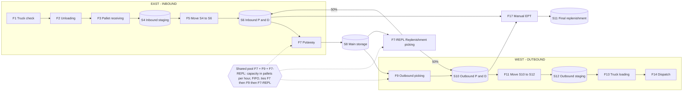

# Warehouse Live Simulator

A browser-based, live (animated) simulator of a manual warehouse: flow, stock capacity, dwell and cycle time, and people required.
It runs entirely in your browser - no server, no installation, nothing is sent over the network.

**Live simulator:** https://YOUR-GITHUB-USERNAME.github.io/YOUR-REPOSITORY-NAME/  *(replace with your link after enabling GitHub Pages - see below)*

## What it does
- Simulates inbound (east side) and outbound (west side) pallet flows hour by hour from an editable 24-hour demand profile.
- F7 putaway, F9 outbound picking and F7-REPL replenishment picking share one capacity pool (FIFO, ties F7 then F9 then F7-REPL); every other flow has its own capacity.
- Define each process by people x productivity, or by capacity (the model then gives the people needed).
- Shows stock per area (S4, S6, S8, S10, S12) against capacity, backlog, additional dwell, cycle times, and people needed per hour.
- Tabs: **Live** (animation, KPIs, charts), **Snapshot** (static stock and flow at a chosen time), **Inputs**, **Results** (verdicts, area report, hourly dashboard with red highlighting above a threshold, people, dwell), **Ledgers** (audit trail, CSV), **Scenarios** (save, compare, sensitivity), **Layout**.

## Process flow

## How to use
1. Open the live link above (Edge or Chrome).
2. Press **Start** on the Live tab (or **Run to end**), then open **Results**.
3. Change values on the **Inputs** tab to test other cases; use **Scenarios** to save and compare them.
Saved scenarios stay in your own browser.

## Files
| File | Purpose |
|---|---|
| index.html | The complete simulator in one file (this is what GitHub Pages serves) |
| src/ | The same program as separate files: index.html, engine.js (simulation), pp.js (screens), layout.png |
| docs/process-flow.mmd | Mermaid source of the process flow diagram |

To run locally, download index.html and open it in a browser.

## Status
Baseline reference results and the full specification are in the Business Requirements Document (version 2.1), which is kept outside this repository.